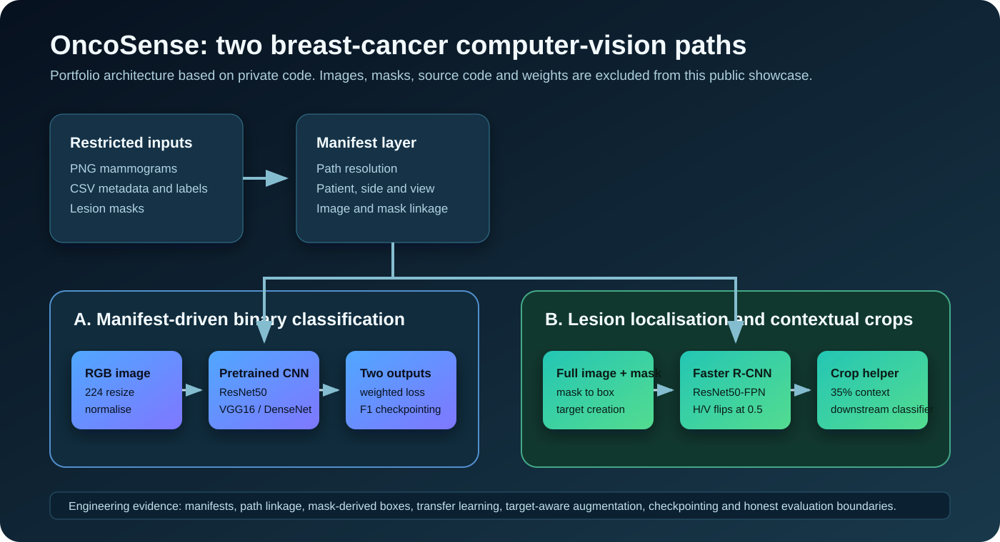
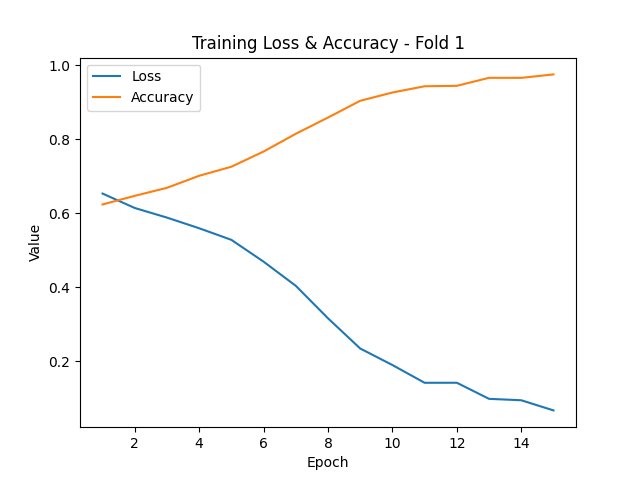

# Mammography AI: Computer Vision & Data Pipeline Showcase

> Portfolio summary of an internship deep-learning project. The implementation, data, model weights, and clinical records remain private.

## The project in brief

This work explored a computer-vision workflow for mammography images. The objective was to structure image metadata and lesion annotations, prepare model-ready inputs, and train transfer-learning classifiers for binary lesion-pathology experiments.

The project demonstrates practical ML and data-engineering work around medical imaging: data preparation, image transformation, PyTorch data loading, experiment tracking, and model artifacts.

## What I worked on

| Area | Applied concepts |
| --- | --- |
| Data preparation | CSV metadata, image-path resolution, label mapping, train/test manifests, image-role handling |
| Image processing | PNG loading, grayscale-to-RGB conversion, resizing, normalization, lesion-region preparation |
| Deep learning | Transfer learning with ResNet50, VGG16, and DenseNet121; a two-class classification head |
| Training | Weighted cross-entropy for class imbalance, Adam optimization, early stopping, checkpointing, optional mixed precision |
| Computer vision | A Faster R-CNN exploration for lesion-region detection; bounding boxes derived from annotation masks |
| Evaluation | Accuracy, precision, recall, F1, loss and learning-curve tracking |

## Workflow

The image data and source annotations are processed into structured manifests. Those manifests feed model-specific loaders and training runs. Checkpoints and learning curves support experiment comparison and iteration.

## Training artifact

This is an exploratory training artifact from the private work. It shows optimization progress during one run; it is **not** presented as clinical performance, diagnostic accuracy, or an end-to-end validation result.

## Technical stack

`Python` · `PyTorch` · `Torchvision` · `Pandas` · `NumPy` · `Pillow` · `OpenCV` · `scikit-learn` · `Matplotlib` · `TensorBoard`

## Repository boundary

This public showcase deliberately excludes:

- Source code and notebooks created during the internship
- Patient-derived images, annotations, and metadata
- Trained checkpoints, experiment logs, and full reports
- Private paths, credentials, and environment files

The diagrams and documentation explain the technical work without distributing restricted material.

## What I would improve next

For a future reproducible research release, I would formalize a validated dataset manifest, use patient-level split controls, add a held-out evaluation protocol, version experiments and configurations, and publish only approved aggregate results and synthetic examples.

See [the technical overview](docs/technical-overview.md), [safe pseudocode](docs/pseudocode.md), and [publication boundaries](docs/publication-boundaries.md).
