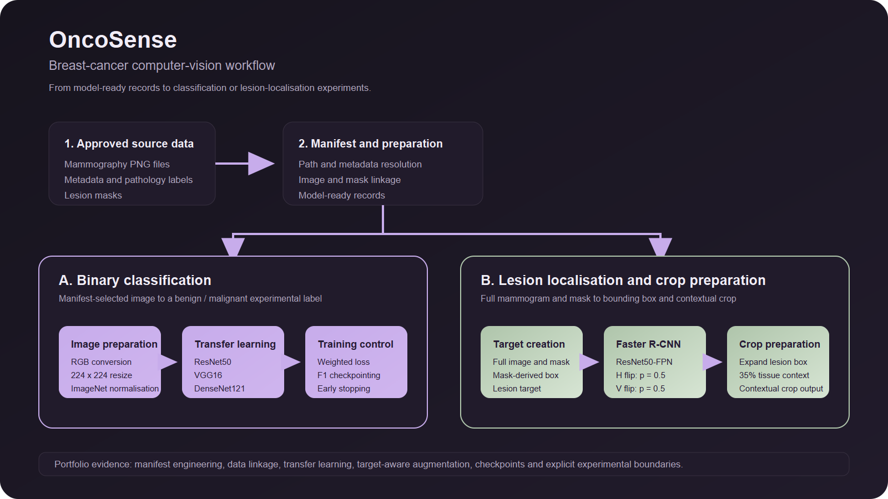

# OncoSense visual gallery

## Computer-vision architecture

The architecture visual uses the portfolio interface palette: charcoal panels, lavender accents and muted sage. It describes the classification and lesion-localisation paths implemented in the private project.

## Existing training artefact

This is the unchanged learning-curve image found with the private ResNet50 checkpoints. It represents one exploratory run; no clinical-performance conclusion is attached to it.

These are an architecture graphic and a training plot, not application-interface screenshots. No application screenshots were located in the inspected project assets, so none have been fabricated.
